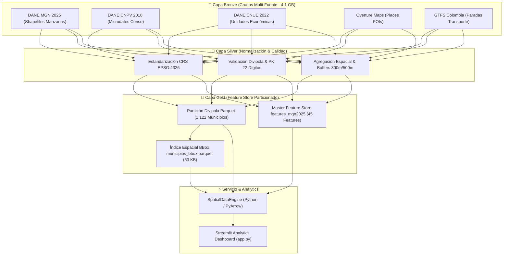

# 🗺️ GeoDataIQ Colombia: Enterprise Geospatial Feature Store & Spatial Routing Engine

[](https://github.com/AndresSantiagoJimenez/Coordenadas_demo/actions/workflows/ci.yml)
[](https://github.com/AndresSantiagoJimenez/Coordenadas_demo/actions/workflows/security.yml)
[](https://www.python.org/downloads/)
[](https://github.com/astral-sh/uv)
[](https://parquet.apache.org/)
[](https://bandit.readthedocs.io/)
[](LICENSE)

> **Plataforma de Alto Rendimiento para Enrutamiento Espacial, Enriquecimiento Sociodemográfico y Gobierno de Datos a Escala Nacional.**  
> Procesa y enriquece coordenadas geográficas en Colombia en **milisegundos**, cruzando más de **541,000 manzanas censales** y **1,122 municipios** a partir de datos del **DANE (MGN, CNPV, CNUE)**, **Overture Maps Foundation**, **GTFS** y la **Red Vial Nacional**.

---

## 🌟 Aspectos Destacados de Ingeniería y Arquitectura

* ⚡ **Enrutamiento Jerárquico de Baja Latencia (<150 ms)**: Algoritmo en 4 niveles (Macro BBox $\to$ Partición Municipal $\to$ Point-in-Polygon $\to$ Predicate Pushdown).
* 🗄️ **Particionamiento Horizontal Espacial**: 1,122 archivos columnar Parquet particionados por código Divipola municipal, eliminando cuellos de botella de memoria.
* 🚀 **Columnar Pruning & PyArrow Pushdown**: Optimización I/O que reduce el consumo de RAM de **~650 MB a menos de 15 MB por consulta** (reducción del 97.7%).
* 🛡️ **Gobierno y Calidad de Datos (Data Governance)**: Motor de validación de calidad en tiempo de ejecución (Quality Score, completitud, sintaxis Divipola e integridad de clave primaria de 22 dígitos).
* 🔒 **Cumplimiento Legal y Ético**: Estricta adhesión a la **Ley 1581 de 2012 (Habeas Data)** y la **Ley 2335 de 2023 DANE (Secreto y Reserva Estadística)** mediante agregación espacial sin PII.
* 🖥️ **Dashboard Interactivo Profesional**: Visualización web en **Streamlit + Folium + Plotly** con polígonos vectoriales DANE en tiempo real, buffers de 300m, KPIs de proximidad comercial y exportación en JSON/CSV.
* 🔐 **Seguridad Integral de Repositorio**: `CODEOWNERS`, Workflows de GitHub Actions (CI & Auditoría de Seguridad con Bandit y pip-audit), políticas `SECURITY.md` y reglas de protección de ramas.

---

## 🏛️ Arquitectura de Datos (Medallion Pattern)



Para una explicación exhaustiva del diseño técnico y benchmarks, consulta [`docs/ARQUITECTURA_DATOS.md`](docs/ARQUITECTURA_DATOS.md).

---

## 📊 Fuentes de Datos Integradas (Feature Store)

El Feature Store consolida **45 variables analíticas** organizadas en dimensiones clave:

1. **Marco Geoestadístico Nacional (DANE MGN 2025)**: Geometrías vectoriales de manzanas urbanas, área en $m^2$, centroides y proyección de viviendas 2018-2025.
2. **Censo Nacional de Unidades Económicas (DANE CNUE 2022)**: Densidad de comercios de proximidad (droguerías, panaderías, restaurantes, supermercados, cárnicos, licoreras).
3. **Censo Nacional de Población y Vivienda (DANE CNPV 2018)**: Porcentaje de estratos socioeconómicos (1-2 vs 5-6), nivel educativo (bachillerato, universidad), acceso a internet y tipología de vivienda.
4. **Overture Maps Foundation (Places Theme)**: Puntos de interés en radios caminables de 300m y 500m (bancos, colegios, supermercados, restobares) y distancia euclidiana mínima.
5. **Transporte Integrado (GTFS Colombia)**: Proximidad en metros a estaciones de transporte masivo (TransMilenio, Metro Medellín, MIO Cali, Transmetro, etc.).
6. **Red Vial Nacional (Invías / OpenStreetMap)**: Distancias a vías secundarias y primarias, jerarquía vial y conectores nodales a 50m, 100m y 300m.

Para consultar la definición formal de cada variable y sus reglas de validación, revisa [`docs/GOBIERNO_Y_CALIDAD_DATOS.md`](docs/GOBIERNO_Y_CALIDAD_DATOS.md).

---

## 🖥️ Dashboard Interactivo (Streamlit + Folium + Plotly)

El dashboard permite ingresar cualquier coordenada de Colombia (o seleccionar ciudades principales con un clic) para obtener instantáneamente el perfil enriquecido de la manzana:

* **Mapa Interactivo**: Centrado automático, marcador del punto, polígono vectorial de la manzana DANE renderizado en tiempo real y círculo de caminabilidad de 300 metros.
* **KPI Scorecards**: Área, estrato predominante, número de unidades económicas y distancia al transporte público.
* **Gráficos Plotly**: Mezcla comercial de proximidad, distribución de nivel educativo y distancias de accesibilidad.
* **Auditoría de Gobierno y Calidad**: Panel con el score de calidad de datos (0-100%), reglas verificadas y linaje de las fuentes.
* **Interoperabilidad**: Botones de exportación inmediata de la manzana consultada a formato **JSON** o **CSV**.

---

## 🚀 Inicio Rápido (Quickstart)

El proyecto utiliza **[`uv`](https://github.com/astral-sh/uv)**, el gestor de paquetes y entornos de Python más rápido del ecosistema moderno.

### 1. Clonar el repositorio
```bash
git clone https://github.com/AndresSantiagoJimenez/Coordenadas_demo.git
cd Coordenadas_demo
```

### 2. Instalar dependencias con `uv` (en segundos)
```bash
# Sincroniza el entorno virtual con todas las dependencias
uv sync
```
*(Alternativa tradicional con pip: `python -m pip install -e .`)*

### 3. Lanzar el Dashboard Interactivo
```bash
uv run streamlit run app.py
```
Abre automáticamente tu navegador en `http://localhost:8501`.

> [!NOTE]
> **Modo Demostración / Portafolio**: El repositorio incluye un dataset de muestra pre-empaquetado (`data/sample/`) para que cualquier persona que clone el repositorio pueda probar el dashboard y las pruebas de inmediato, sin necesidad de descargar los 3.2 GB de datos crudos. Cuando los datos completos DANE están presentes localmente, el sistema los detecta y desbloquea automáticamente toda la cobertura nacional.

---

## 🧪 Pruebas Unitarias y Auditoría de Seguridad

### Ejecutar Suite de Pruebas (Pytest):
```bash
uv run pytest test/ -v --cov=src
```

### Ejecutar Auditoría de Seguridad de Código (Bandit):
```bash
uv run bandit -r src/
```

---

## 🛡️ Sistema de Seguridad y Control de Acceso del Repositorio

A pesar de ser un repositorio **público** para exhibición de portafolio, se ha implementado un esquema de seguridad de nivel empresarial:

1. **Autorización Exclusiva de Actualización**:
   - En repositorios personales de GitHub, **únicamente el propietario (`@AndresSantiagoJimenez`) tiene permisos de escritura (`git push`)**.
   - Ningún usuario externo puede modificar ramas ni subir código; cualquier contribución externa debe realizarse obligatoriamente mediante un `Fork` y un `Pull Request`.
2. **Asignación de Propiedad (`.github/CODEOWNERS`)**:
   - Todo el código requiere la revisión y aprobación exclusiva de `@AndresSantiagoJimenez`.
3. **Branch Protection Rules (Protección de Rama `main`)**:
   - Bloqueo de `Force Pushes` (`git push --force`).
   - Bloqueo de eliminación accidental de la rama principal.
   - Requerimiento de comprobaciones de CI (`test-and-security`) antes de integrar cambios.
4. **Protección contra Fuga de Secretos y Datos Pesados**:
   - `.gitignore` blindado que excluye datos crudos mayores a 100 MB y credenciales `.env`.
   - Pre-commit hooks (`.pre-commit-config.yaml`) que escanean llaves privadas y archivos mayores a 5 MB antes de confirmar un commit.

Consulta la guía completa de seguridad en [`SECURITY.md`](SECURITY.md).

---

## 📂 Estructura del Proyecto

```text
PORTAFOLIO_ANDRES/
├── .github/
│   ├── CODEOWNERS                  # Propiedad exclusiva de @AndresSantiagoJimenez
│   └── workflows/
│       ├── ci.yml                  # Pipeline CI: Pytest, Cobertura, Bandit
│       └── security.yml            # Auditoría semanal de dependencias (pip-audit)
├── Data/
│   ├── metadata/
│   │   └── municipios_bbox.parquet # Índice espacial ultraligero (53 KB, 1,122 municipios)
│   └── sample/
│       ├── manzanas_sample.parquet # Geometrías de muestra (Bogotá, Medellín, Cali, etc.)
│       └── features_master_sample.parquet # Features de muestra
├── docs/
│   ├── ARQUITECTURA_DATOS.md       # Diagramas C4/Mermaid, particionamiento y benchmarks
│   └── GOBIERNO_Y_CALIDAD_DATOS.md # Diccionario 45 variables, linaje y Ley 1581/2335
├── src/
│   ├── __init__.py                 # Paquete principal
│   ├── config.py                   # Configuración centralizada, rutas y constantes
│   ├── engine.py                   # SpatialDataEngine (enrutamiento de baja latencia)
│   ├── geo_procesamiento.py        # Funciones de geoprocesamiento retrocompatibles
│   └── governance.py               # Catálogo de metadatos y motor de calidad de datos
├── test/
│   ├── test_engine.py              # Pruebas del motor espacial y benchmarks
│   ├── test_geo_procesamiento.py   # Pruebas de integración espacial
│   └── test_governance.py          # Pruebas de reglas de calidad y claves primarias
├── app.py                          # Dashboard interactivo Streamlit + Folium + Plotly
├── pyproject.toml                  # Configuración de dependencias del proyecto (uv/pip)
├── uv.lock                         # Lockfile determinístico de dependencias
├── .gitignore                      # Exclusión de datos pesados (>100MB) y secretos
├── .pre-commit-config.yaml         # Hooks de pre-commit para seguridad y sintaxis
├── SECURITY.md                     # Políticas de seguridad y configuración de ramas
└── README.md                       # Documento principal de presentación
```

---

## 👨‍💻 Autor

**Andrés Santiago Jiménez**  
*Ingeniero de Datos Senior, Arquitecto de Datos y Especialista en Gobierno de Datos*  
* GitHub: [@AndresSantiagoJimenez](https://github.com/AndresSantiagoJimenez)
* Repositorio: [https://github.com/AndresSantiagoJimenez/Coordenadas_demo](https://github.com/AndresSantiagoJimenez/Coordenadas_demo)
