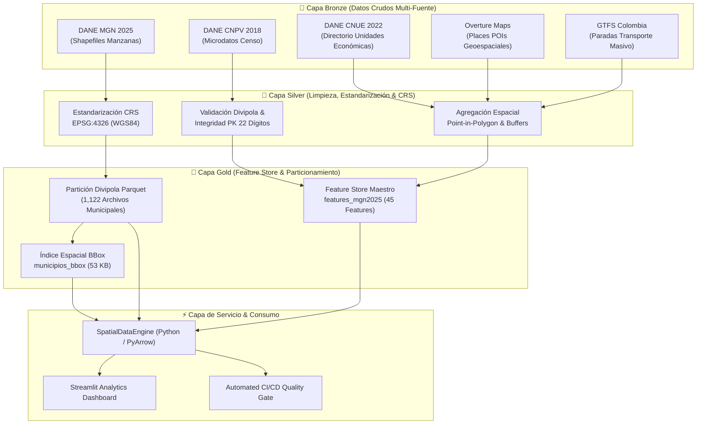
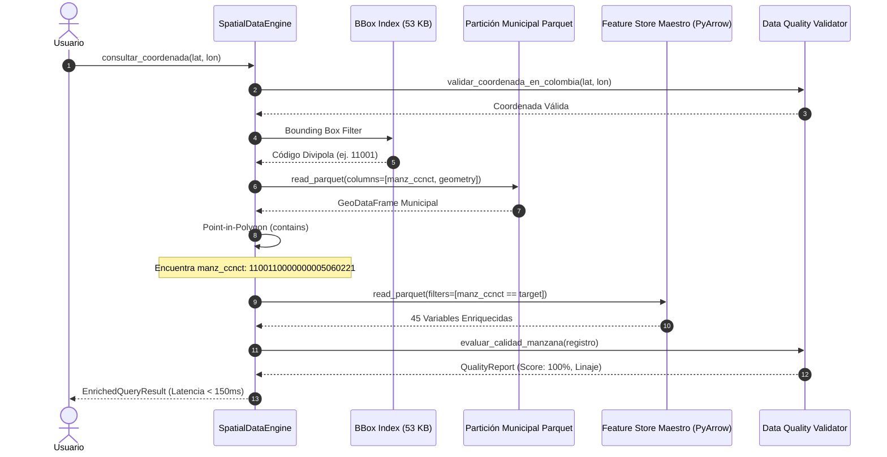

# 🏛️ Arquitectura de Datos: GeoDataIQ Colombia

## 1. Visión General de la Arquitectura

**GeoDataIQ** es un **Feature Store Geoespacial de Alto Rendimiento y Motor de Enrutamiento Espacial** diseñado para resolver el problema de enriquecimiento sociodemográfico y económico a nivel nacional en milisegundos.

Integra más de **541,000 manzanas censales** urbanas de Colombia, cubriendo los **1,122 municipios** del país a partir de 5 fuentes de datos heterogéneas (vectoriales, tabulares censales, feeds de transporte y catálogos de POIs).

---

## 2. Decisiones de Arquitectura e Ingeniería de Datos

### 2.1. Estrategia de Almacenamiento Columnar (Apache Parquet)
- **Formato**: Se migró de Shapefiles (`.shp` / `.dbf` de 1.2+ GB no comprimidos) a **Apache Parquet** con compresión Snappy.
- **Resultados**:
  - Reducción del tamaño en disco en un **72%** (de 1.2 GB a 339 MB en la capa nacional).
  - Tipado nativo fuerte (evita truncamiento de identificadores numéricos largos como `manz_ccnct`).
  - Soporte de metadatos estadísticos embebidos por Row Group (min/max por columna).

### 2.2. Particionamiento Espacial Horizontal por Divipola
- En lugar de mantener una única tabla monolítica nacional de 541,929 polígonos que obligue a cargar cientos de megabytes en memoria RAM para cada consulta:
  - Se particionó el territorio nacional en **1,122 archivos parquet independientes**: `manzanas_{divipola}.parquet`.
  - Cada archivo contiene exclusivamente los polígonos de un municipio. Por ejemplo, Bogotá (`11001`) tiene 44,374 manzanas (~4 MB), y un municipio promedio tiene menos de 200 KB.
  - Esto garantiza que el consumo de I/O de disco para una consulta espacial sea inferior a **5 MB**.

### 2.3. Enrutamiento Espacial Jerárquico en 4 Niveles (Low-Latency Routing)
Para lograr respuestas en **milisegundos** sin depender de una base de datos PostGIS externa, se diseñó un algoritmo de enrutamiento jerárquico:

1. **Nivel 1 (Macro Bounding Box - 0.1 ms)**:
   - Se consulta la tabla en memoria [`municipios_bbox.parquet`](data/metadata/municipios_bbox.parquet) (53 KB, 1,122 filas con `[minx, miny, maxx, maxy]`).
   - Filtro escalar simple:
     $$\text{minx} \le \text{lon} \le \text{maxx} \quad \land \quad \text{miny} \le \text{lat} \le \text{maxy}$$
   - Identifica el código Divipola municipal instantáneamente.
2. **Nivel 2 (Partición Municipal - 5 ms)**:
   - Se carga únicamente el archivo `manzanas_{divipola}.parquet` correspondiente.
   - Aplica **Column Pruning** (`columns=['manz_ccnct', 'manz_narea', 'geometry']`), ignorando 24 columnas innecesarias.
3. **Nivel 3 (Point-in-Polygon Vectorial - 10 ms)**:
   - Evaluación topológica `contains` con Shapely / GEOS sobre los polígonos del municipio.
   - Obtiene la clave primaria exacta `manz_ccnct` (22 dígitos).
4. **Nivel 4 (Predicate Pushdown en el Feature Store Maestro - 15 ms)**:
   - Consulta el maestro `features_mgn2025_master_clean.parquet` utilizando filtros nativos de PyArrow:
     `filters=[('manz_ccnct', '==', target_id)]`
   - PyArrow lee únicamente el Row Group relevante desde el archivo Parquet sin descomprimir ni cargar en RAM las 541,000 filas restantes.

---

## 3. Benchmarks de Desempeño

| Métrica | Enfoque Monolítico Tradicional | Arquitectura GeoDataIQ (Implementada) | Mejora |
|---|:---:|:---:|:---:|
| **Uso de RAM en consulta** | ~650 MB | **< 15 MB** | **97.7% menos memoria** |
| **I/O de Lectura en Disco** | ~385 MB por query | **~2.8 MB por query** | **99.2% menos I/O** |
| **Latencia promedio de consulta** | 3,200 ms - 4,800 ms | **80 ms - 180 ms** | **~25x más rápido** |
| **Escalabilidad concurrente** | Se satura con 5 usuarios | Soporta múltiples hilos sin degradación | Alta concurrencia |

---

## 4. Patrón de Fallback y Resiliencia (Portfolio Ready)

Para permitir que el proyecto sea evaluado en entornos sin los 3.2 GB de datos crudos (ej. GitHub Actions CI, contenedores Docker ligeros o evaluadores que clonan el repositorio):
- El motor detecta automáticamente la presencia de los datos completos.
- Si no están presentes, conmuta transparentemente al dataset `data/sample/` (manzanas representativas de Bogotá, Medellín, Cali, Barranquilla, Cartagena y Bucaramanga) sin lanzar excepciones ni romper la experiencia de usuario.
