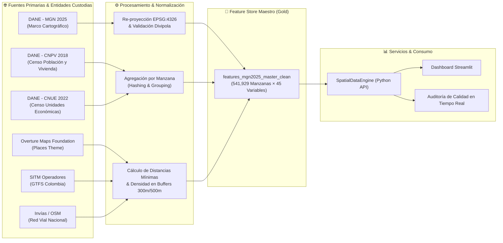

# 🏛️ Marco de Gobierno, Calidad y Linaje de Datos (Data Governance)

## 1. Visión y Marco de Gobernanza (Alineado a DAMA-DMBOK)

El gobierno de datos en **GeoDataIQ** asegura que cada variable sociodemográfica, económica y de infraestructura generada sea **confiable, auditable, trazable y conforme a la regulación nacional colombiana de protección de datos personales y secreto estadístico**.

---

## 2. Linaje de Datos de Extremo a Extremo (Data Lineage)

---

## 3. Diccionario de Datos del Feature Store Maestro

| Variable | Tipo de Dato | Fuente Oficial | Unidad | Nivel de Confidencialidad | Regla de Calidad / Validación |
|---|:---:|:---:|:---:|:---:|---|
| `manz_ccnct` | `String (22)` | DANE MGN 2025 | Código DANE | Pública | Clave primaria. Exactamente 22 caracteres numéricos. No nulo. |
| `mpio_cdpmp` | `String (5)` | DANE Divipola | Código Municipio | Pública | 5 dígitos numéricos. Primeros 2 dígitos pertenecen a la lista de 33 departamentos. |
| `clas_ccdgo` | `String (1)` | DANE MGN 2025 | Clasificación | Pública | `1`: Urbano, `2`: Rural disperso, `3`: Centro poblado. |
| `latitud` | `Float` | DANE MGN 2025 | Grados decimales | Pública | En rango $[-4.3, 13.5]$. |
| `longitud` | `Float` | DANE MGN 2025 | Grados decimales | Pública | En rango $[-81.8, -66.8]$. |
| `manz_narea` | `Float` | DANE MGN 2025 | $m^2$ | Pública | Numérico estrictamente $> 0$. |
| `tvivienda` | `Float` | DANE CNPV 2018 | Conteo | Agregada Estadística | $\ge 0$. Total viviendas censadas. |
| `viv_2025` | `Float` | DANE MGN 2025 | Conteo | Agregada Estadística | $\ge 0$. Estimación actualizada de viviendas a 2025. |
| `viv_delta_2018_2025`| `Float` | Derivada | Conteo | Agregada Estadística | Diferencia neta de viviendas `viv_2025 - tvivienda`. |
| `cnue_total_ue` | `Float` | DANE CNUE 2022 | Conteo | Agregada Estadística | $\ge 0$. Total establecimientos económicos en la manzana. |
| `cnue_n_drogueria` | `Float` | DANE CNUE 2022 | Conteo | Agregada Estadística | $\ge 0$. Farmacias y droguerías de barrio. |
| `cnue_n_panaderia` | `Float` | DANE CNUE 2022 | Conteo | Agregada Estadística | $\ge 0$. Panaderías y pastelerías. |
| `cnue_n_restaurante`| `Float` | DANE CNUE 2022 | Conteo | Agregada Estadística | $\ge 0$. Expendio a la mesa de comidas preparadas. |
| `cnue_n_super_tiendas`| `Float`| DANE CNUE 2022 | Conteo | Agregada Estadística | $\ge 0$. Supermercados, minimercados y abarrotes. |
| `cnue_n_carnicos` | `Float` | DANE CNUE 2022 | Conteo | Agregada Estadística | $\ge 0$. Carnicerías y expendios de carnes. |
| `cnue_n_licorera` | `Float` | DANE CNUE 2022 | Conteo | Agregada Estadística | $\ge 0$. Licoreras y estancos. |
| `ovt_n_poi_300m` | `Integer` | Overture Maps | Conteo | Pública (Open Data) | $\ge 0$. Puntos de interés en radio caminable de 300m. |
| `ovt_dist_min_m` | `Float` | Overture Maps | Metros | Pública (Open Data) | $\ge 0$. Distancia euclidiana mínima al POI más cercano. |
| `via_dist_secundaria_m`| `Float`| Red Vial / OSM | Metros | Pública | $\ge 0$. Distancia a la vía secundaria más cercana. |
| `via_dist_primaria_m` | `Float`| Invías / OSM | Metros | Pública | $\ge 0$. Distancia a la vía primaria o autopista. |
| `gtfs_dist_parada_m` | `Float` | GTFS Operadores | Metros | Pública | $\ge 0$ o `Null` si la ciudad no cuenta con sistema GTFS. |
| `gtfs_disponible` | `Boolean` | GTFS Operadores | Booleano | Pública | `True` si el municipio tiene cobertura de transporte masivo. |
| `cnpv_pct_estrato_bajo`| `Float`| DANE CNPV 2018 | Proporción | Agregada Estadística | Proporción de hogares en estratos 1 y 2. Rango $[0.0, 1.0]$. |
| `cnpv_pct_estrato_alto`| `Float`| DANE CNPV 2018 | Proporción | Agregada Estadística | Proporción de hogares en estratos 5 y 6. Rango $[0.0, 1.0]$. |
| `cnpv_pct_con_internet`| `Float`| DANE CNPV 2018 | Proporción | Agregada Estadística | Proporción de viviendas con servicio de internet. $[0.0, 1.0]$. |
| `cnpv_pct_secundaria` | `Float` | DANE CNPV 2018 | Proporción | Agregada Estadística | Proporción de residentes con bachillerato. $[0.0, 1.0]$. |
| `cnpv_pct_superior` | `Float` | DANE CNPV 2018 | Proporción | Agregada Estadística | Proporción de residentes con educación universitaria. $[0.0, 1.0]$. |
| `cnpv_pct_sin_educ` | `Float` | DANE CNPV 2018 | Proporción | Agregada Estadística | Proporción de residentes sin educación formal. $[0.0, 1.0]$. |
| `cnpv_pct_apto` | `Float` | DANE CNPV 2018 | Proporción | Agregada Estadística | Proporción de viviendas en apartamentos. $[0.0, 1.0]$. |
| `cnpv_pct_cuarto` | `Float` | DANE CNPV 2018 | Proporción | Agregada Estadística | Proporción de viviendas en cuartos / inquilinatos. $[0.0, 1.0]$. |
| `cnpv_pct_uso_mixto` | `Float` | DANE CNPV 2018 | Proporción | Agregada Estadística | Proporción de inmuebles con uso mixto. $[0.0, 1.0]$. |

---

## 4. Reglas del Motor de Calidad de Datos (Data Quality Engine)

El módulo [`src/governance.py`](../src/governance.py) implementa en tiempo de ejecución validaciones automáticas:

1. **Integridad de Clave Primaria (Primary Key Integrity)**:
   - Verificación sintáctica estricta de `manz_ccnct`: longitud exacta de 22 dígitos numéricos.
2. **Validación Geográfica de Límites (Geographical Boundary Checks)**:
   - Coordenadas geográficas forzadas dentro del Bounding Box de la República de Colombia.
3. **Validación Referencial Divipola (Referential Integrity)**:
   - Código de municipio de 5 dígitos cruzado contra el maestro de 33 departamentos oficiales.
4. **Validación de Rangos de Dominio (Domain Range Checks)**:
   - Porcentajes censales confinados estrictamente en el intervalo $[0.0, 1.0]$.
   - Distancias físicas euclidianas no negativas ($\ge 0$).
   - Conteos de unidades económicas y POIs $\ge 0$.
5. **Cálculo de Score de Calidad (Data Quality Score)**:
   - Indicador porcentual de 0 a 100% calculado para cada registro devuelto al usuario en el dashboard.

---

## 5. Marco Legal, Ético y Cumplimiento Normativo (Compliance)

### 5.1. Ley Estatutaria 1581 de 2012 (Habeas Data & Protección de Datos Personales)
- **Principio de No Identificación**: Ninguna capa de este Feature Store contiene información de identificación personal (PII) como nombres, cédulas, teléfonos o direcciones exactas de personas naturales.
- **Anonimización por Agregación Espacial**: Todos los atributos demográficos y socioeconómicos están agregados a nivel de manzana censal (mínimo polígono estadístico), impidiendo la reidentificación de hogares individuales.

### 5.2. Ley 79 de 1993 y Ley 2335 de 2023 (Secreto y Reserva Estadística del DANE)
- La legislación colombiana consagra el **Principio de Secreto Estadístico**, el cual estipula que los datos individuales suministrados al DANE no podrán darse a conocer en forma nominativa ni servir para fines tributarios, judiciales o de policía.
- Este proyecto da estricto cumplimiento a dicho mandato legal, consumiendo exclusivamente los agregados oficiales certificados por el DANE para fines de analítica y planeación territorial.
